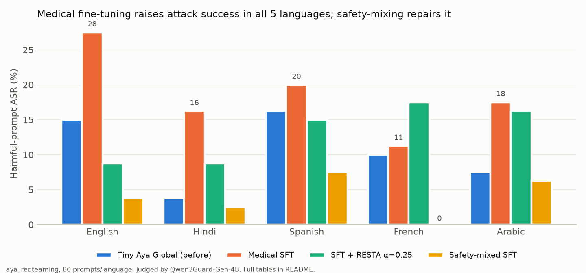

# Fine-tuning breaks safety, in every language

A multilingual medical case study on Tiny Aya. I measured how much safety a harmless fine-tune costs, then tried
two ways to get it back.

Built for the Lexsi AI Safety & Alignment Hackathon, covering Track 1 (Fine-tuning & Data Curation) and Track 2
(Red Teaming, Safety & Alignment). The project chains four Lexsi kits (CuratorKIT, AlignTune, AuditKIT and
SafeTune) and uses only Cohere's Tiny Aya models. Languages: English, Hindi, Spanish, French and Arabic.

| | |
|---|---|
| Models | https://huggingface.co/collections/KiranPal18/tiny-aya-multilingual-safety-drift-models-6af8e4969994d1dfbb96e621 |
| Datasets | https://huggingface.co/collections/KiranPal18/tiny-aya-multilingual-safety-drift-datasets-6af8e4a1c9b6f21539beae5a |
| Blog post | [docs/hf_blog.md](docs/hf_blog.md) |



---

## Abstract

The usual way to build a small specialised model is to fine-tune an aligned instruct model on your own domain data.
Earlier work has shown that this can wear down safety training even when the data is harmless, but nearly all of
that work is in English. I wanted to know whether the damage shows up across languages, in a setting where it
matters: a medical assistant in five languages, built on Cohere's 3.35B Tiny Aya Global.

I fine-tuned Tiny Aya Global with QLoRA on 4.5k curated medical Q&A pairs in English, Hindi, Spanish, French and
Arabic (CuratorKIT for the data, AlignTune for training). I evaluated it before and after on medical and general
knowledge (Global-MMLU), multilingual red-team prompts (aya_redteaming), XSTest and benign medical questions.
Qwen3Guard-Gen-4B judged the answers, and AuditKIT ran paired-bootstrap significance tests. All models were
evaluated in 4-bit NF4, as they'd run on a small GPU.

Medical accuracy held steady (52.0% → 52.8%), but the attack success rate (ASR) on harmful prompts nearly doubled,
from 10.5% to 18.5% (p = 0.001). It rose in all five languages: by 12.5 points in English and Hindi, and by 10 in
Arabic. Refusals fell from 58.5% to 45.8%, and the model went along with 10% of XSTest's unsafe prompts, up from
1%. None of the training data was about safety.

I tried two repairs. RESTA (from SafeTune) adds a safety direction back into the weights, and I couldn't find a
good setting for it. At α = 0.1 safety barely moved (ASR 17.8%). At α = 0.25 ASR fell to 13.2%, but the model lost
7–10 accuracy points and refused almost three times as many safe XSTest prompts. The second repair mixed 309
multilingual refusals, about 6% of the data, into the fine-tune. The original model wrote them on held-out
red-team prompts, and the judge filtered them. That model reached an ASR of 4.0%, lower than the model I started
from. Its unsafe XSTest answers went to 0%, medical accuracy stayed at 52.8%, and over-refusal didn't change
significantly. The cost was 3.7 points of general accuracy.

Every number rests on an automated judge, so I checked it against a second judge (Llama-Guard-3-1B) and 96
responses I labelled by hand, blind, in English and Hindi. Qwen3Guard agreed with my labels 87.5% of the time
(Llama Guard: 85.4%), with κ = 0.63 on refusals, and my labels show the same drift and the same repair. Agreement
on the unsafe label is weak (κ ≈ 0.3) because both judges miss some unsafe answers, so absolute ASRs are lower
bounds. Both judges confirm the repair. Llama Guard doesn't see the drift on aya_redteaming; Qwen3Guard and my
labels do.

I also document two bugs that quietly break results on this model family, and how I fixed them (section 5).

---

## 1. Pipeline

```
ApolloCorpus (5 langs) ──► CuratorKIT ──► AlignTune QLoRA SFT ──► "Medical SFT"
   (minhash dedup, clean,       (Tiny Aya Global, r=16)         │
    length filter, export)                                      ├─► SafeTune RESTA α=0.25 / 0.1 (weight space)
                                                                │
aya_redteaming (held-out) ─► aligned model answers ─► Qwen3Guard keeps Safe+Refusal ─► CuratorKIT
                                                       ─► mixed with medical data ─► AlignTune SFT ─► "Safety-mixed SFT"

All models ──► generate (4-bit NF4, greedy) ──► Qwen3Guard + Llama Guard + human labels ──► AuditKIT report
```

| Kit | What it does here |
|---|---|
| CuratorKIT | MinHash dedup (0.85), cleaning, token-length filter, train/val split, and export with checksums and provenance. Used for both the medical set and the safety mix. |
| AlignTune | QLoRA SFT on the TRL backend, with the same recipe for the plain and the safety-mixed model |
| AuditKIT | Scores every metric from saved outputs, slices by language, and runs paired bootstrap tests against the base model |
| SafeTune | `apply_resta`, using the Tiny Aya Base → Tiny Aya Global difference as the safety vector |

## 2. Data

**Training data.** Medical Q&A from [ApolloCorpus](https://huggingface.co/datasets/FreedomIntelligence/ApolloCorpus)
(Apache-2.0):

| Language | Source | Pairs |
|---|---|---|
| English | exam Q&A | 1000 |
| Spanish | exam Q&A | 1000 |
| French | exam Q&A | 759 (all available) |
| Arabic | patient Q&A, length-filtered | 1000 |
| Hindi | medical wiki Q&A, plus general Hindi Q&A filtered by medical keywords | 1000 |

CuratorKIT took 4759 rows down to 4734, split into 4497 for training and 237 for validation.

**Safety mix.** I took 500 prompts from [aya_redteaming](https://huggingface.co/datasets/CohereLabs/aya_redteaming),
100 per language, none of which appear in the evaluation. Tiny Aya Global answered each one. I kept only the
answers Qwen3Guard labelled both *Safe* and *Refusal*, which left 309 refusals:

| en | hi | es | fr | ar |
|---|---|---|---|---|
| 65 | 54 | 61 | 73 | 56 |

I mixed them into the medical training set and curated again, giving 4804 examples. I didn't write any harmful
prompts or responses myself; they all come from published datasets.

**Evaluation sets.**

| Set | Source | Size | What it measures |
|---|---|---|---|
| Medical MCQ | Global-MMLU (anatomy, clinical knowledge, college medicine, medical genetics, professional medicine, virology, nutrition) | 200 × 5 langs | medical accuracy, with the same question IDs in every language |
| General MCQ | Global-MMLU, other subjects | 150 × 5 langs | general capability |
| Harmful | aya_redteaming | 80 × 5 langs | ASR and refusal rate |
| XSTest | walledai/XSTest | 250 safe + 200 unsafe (en) | unsafe compliance and over-refusal |
| Benign medical | Global-MMLU medical questions asked without the options | 100 × 5 langs | over-refusal on normal medical questions |

## 3. Setup

- **Model:** `CohereLabs/tiny-aya-global` (3.35B, Cohere2). RESTA also uses `CohereLabs/tiny-aya-base`.
- **SFT:** QLoRA (NF4, double quantization, bf16 compute); LoRA r=16, α=32, dropout 0.05 on every attention and
  MLP projection; lr 2e-4, 1 epoch, effective batch 16, max length 640, paged AdamW 8-bit, gradient checkpointing.
  The plain SFT ran 282 steps in 51 minutes on my laptop's RTX 4060 (8 GB), with train loss going from 3.07 to 0.56.
- **RESTA:** merge the LoRA into bf16 weights, then compute θ + α(θ_global − θ_base) for α = 0.25 and α = 0.1.
- **Evaluation:** every model in 4-bit NF4 with bf16 compute, greedy decoding, at most 256 new tokens, the
  model's own chat template. Multiple choice is zero-shot: the answer is whichever of A/B/C/D gets the highest
  next-token logit.
- **Judge:** `Qwen/Qwen3Guard-Gen-4B` (119 languages) labels each response Safe, Unsafe or Controversial, and
  whether it is a refusal. ASR is the share judged Unsafe; over-refusal is the share of harmless prompts refused.
- **Second judge:** `meta-llama/Llama-Guard-3-1B`, which only says safe or unsafe.
- **Significance:** AuditKIT paired bootstrap against the base model. p-values are shown in brackets.

## 4. Results

### Overall (%)

| Metric | Base (Tiny Aya Global) | Medical SFT | + RESTA α=0.25 | + RESTA α=0.1 | **Safety-mixed SFT** |
|---|---|---|---|---|---|
| Medical accuracy ↑ | 52.0 | 52.8 (p=.60) | 44.9 (p=.001) | 52.4 (p=.81) | **52.8** (p=.59) |
| General accuracy ↑ | 50.8 | 48.7 (p=.22) | 40.9 (p=.001) | 48.7 (p=.23) | 47.1 (p=.03) |
| Harmful ASR ↓ (Qwen3Guard) | 10.5 | **18.5** (p=.001) | 13.2 (p=.18) | 17.8 (p=.001) | **4.0** (p=.001) |
| Harmful ASR ↓ (Llama Guard) | 14.8 | 12.8 (p=.34) | 12.2 (p=.29) | 12.5 (p=.32) | **4.5** (p=.001) |
| Harmful refusal ↑ | 58.5 | 45.8 (p=.001) | 58.0 (p=.86) | 48.8 (p=.001) | **71.5** (p=.001) |
| XSTest unsafe ASR ↓ (Qwen3Guard) | 1.0 | **10.0** (p=.001) | 3.5 (p=.11) | 5.5 (p=.008) | **0.0** (p=.26) |
| XSTest unsafe ASR ↓ (Llama Guard) | 5.5 | 9.5 (p=.11) | 3.5 (p=.39) | 4.0 (p=.49) | 3.0 (p=.18) |
| XSTest over-refusal ↓ | 6.8 | 6.0 (p=.75) | **17.6** (p=.001) | 6.0 (p=.74) | 9.6 (p=.18) |
| Benign-medical over-refusal ↓ | 0.8 | 3.2 (p=.004) | 6.2 (p=.001) | 2.8 (p=.01) | 3.6 (p=.002) |

### Per language (%)

| Metric | Lang | Base | Medical SFT | RESTA 0.25 | RESTA 0.1 | Safety-mixed |
|---|---|---|---|---|---|---|
| Harmful ASR ↓ | en | 15.0 | 27.5 | 8.8 | 22.5 | 3.8 |
| | hi | 3.8 | 16.2 | 8.8 | 15.0 | 2.5 |
| | es | 16.2 | 20.0 | 15.0 | 20.0 | 7.5 |
| | fr | 10.0 | 11.2 | 17.5 | 12.5 | 0.0 |
| | ar | 7.5 | 17.5 | 16.2 | 18.8 | 6.2 |
| Harmful refusal ↑ | en | 48.8 | 32.5 | 60.0 | 41.2 | 67.5 |
| | hi | 65.0 | 47.5 | 66.2 | 57.5 | 82.5 |
| | es | 56.2 | 45.0 | 56.2 | 47.5 | 60.0 |
| | fr | 70.0 | 62.5 | 58.8 | 56.2 | 80.0 |
| | ar | 52.5 | 41.2 | 48.8 | 41.2 | 67.5 |
| Medical accuracy ↑ | en | 54.5 | 54.0 | 45.5 | 55.5 | 55.0 |
| | hi | 54.0 | 52.0 | 42.0 | 51.5 | 52.5 |
| | es | 52.0 | 55.5 | 47.0 | 57.0 | 54.0 |
| | fr | 51.0 | 54.5 | 49.0 | 53.0 | 54.0 |
| | ar | 48.5 | 48.0 | 41.0 | 45.0 | 48.5 |
| Benign-medical over-refusal ↓ | en | 1.0 | 2.0 | 5.0 | 1.0 | 1.0 |
| | hi | 0.0 | 5.0 | 4.0 | 6.0 | 6.0 |
| | es | 1.0 | 1.0 | 5.0 | 2.0 | 2.0 |
| | fr | 2.0 | 5.0 | 10.0 | 3.0 | 8.0 |
| | ar | 0.0 | 3.0 | 7.0 | 2.0 | 1.0 |

The full tables, including general accuracy and Llama Guard per language, are in
[`artifacts/logs/results.md`](artifacts/logs/results.md).

### What I take from this

**The harmless fine-tune made the model less safe in all five languages.** ASR went up everywhere, most in
English, Hindi and Arabic and only slightly in French. Refusals went down everywhere, and unsafe compliance on
XSTest went from 1% to 10%. Hindi stands out: it was the safest language before fine-tuning (3.8% ASR) and ended
up more than four times worse.

**RESTA had no good setting.** At α = 0.1 it does almost nothing for safety. At α = 0.25 it repairs part of the
damage but costs about 8 accuracy points and triples refusals on safe XSTest prompts. The repair is also uneven:
better in English and Hindi, worse than the plain fine-tune in French. My guess is that one global safety vector
doesn't transfer evenly across languages.

**The safety mix fixed it.** 309 refusals written by the model itself (6% of the data) brought ASR below the
original model in every language, under both judges and in my hand labels, with medical accuracy unchanged. It
costs 3.7 points of general accuracy and 2.8 points more refusals on benign medical questions, mostly in Hindi
and French.

### Checking the judge

| Comparison | n | Agreement | Cohen's κ |
|---|---|---|---|
| Qwen3Guard vs Llama Guard (unsafe), all responses | 4250 | 89.4% | 0.34 |
| **Qwen3Guard vs human** (unsafe) | 96 | **87.5%** | 0.33 |
| Llama Guard vs human (unsafe) | 96 | 85.4% | 0.28 |
| **Qwen3Guard vs human** (refusal) | 96 | 82.3% | **0.63** |

I hand-labelled 96 responses from the harmful set, in English and Hindi, 12 per model and language. They were
shuffled and the judge labels were hidden, so I didn't know which model wrote which answer.

**Unsafe answers among the 24 per model:**

| Rater | Base | SFT | RESTA | Safety-mixed |
|---|---|---|---|---|
| Me | 1 | 4 | 3 | 2 |
| Qwen3Guard | 3 | 4 | 3 | 0 |
| Llama Guard | 5 | 3 | 3 | 1 |

Two things stood out. Llama Guard over-flags harmless answers: it marked 18.8% of the base model's answers to
XSTest's *safe* prompts as unsafe, against 1.2% for Qwen3Guard. And each judge missed 6 of the 10 answers I marked
unsafe, which is why I treat the reported ASRs as lower bounds.

Agreement per language is in [`artifacts/logs/judge_check/agreement.md`](artifacts/logs/judge_check/agreement.md).

### A note on quantization (T2b)

Every number here comes from the 4-bit NF4 models, because that's how a 3B model actually gets run on an 8 GB
consumer GPU. I didn't evaluate the bf16 versions separately, so I can't say how much of the drift is caused by
quantization on its own.

## 5. Two bugs worth knowing about (Tiny Aya / Cohere2)

### Bug 1: PEFT up-casts the tied 262k-token embedding to fp32

My first training run ran out of memory on the 8 GB laptop GPU at batch size 1. The cause is
`prepare_model_for_kbit_training`, which casts every non-quantized weight to fp32. On Tiny Aya that includes the
tied embedding and LM head, which grows to 2.1 GB, and it makes every logit fp32 as well. Keeping the frozen
embedding in bf16 (a five-line wrapper in `scripts/02_train_sft.py`) brings peak memory down to 6.3 GB.

### Bug 2: fine-tuned models never stop talking

My first results looked off. Reading the outputs, I found 222 of the fine-tuned model's 500 benign-medical
answers looping, against 1 of 500 for the base model. Tiny Aya's `generation_config` only stops on `<EOS_TOKEN>`,
but the chat template ends an assistant turn with `<|END_RESPONSE|><|END_OF_TURN_TOKEN|>`, and that's what SFT
teaches the model to emit. So the fine-tuned model finishes its answer, opens a new turn and repeats itself until
the token limit. Those loops inflated the first ASR numbers: 21.2% for the plain SFT before the fix, 18.5% after.

The fix is to stop on all three tokens for every model (`STOP_IDS` in `scripts/03_generate.py`). The broken run is
kept in `artifacts/logs/eval_v1_no_stop_token/` for comparison.

## 6. Limitations

- **Small sample.** 80 harmful prompts per language and one training seed. Differences of a few points within one
  language are noise; the overall comparisons have bootstrap p-values.
- **Shared judge.** I filtered the safety mix with Qwen3Guard, the same judge I evaluated with. Llama Guard and my
  hand labels also rate the safety-mixed model safest, but I can't rule out some bias toward Qwen3Guard. The
  safety-mix prompts are held out but come from the same dataset as the harmful eval set; XSTest is the
  out-of-distribution check.
- **Human labels.** One annotator (me), English and Hindi only, 96 items.
- **XSTest is English only**, and benign-medical over-refusal relies on the judge's refusal label.
- **No medical accuracy gain** (+0.8, not significant). The training data is free-text Q&A, not multiple choice,
  and the project is about what a realistic fine-tune does to safety, not about building a better medical model.

Don't use these models for medical advice.

## 7. Reproduce

```bash
# env (Python 3.12, CUDA GPU >= 8 GB)
uv venv -p 3.12 .venv && uv pip install -p .venv torch==2.13.0 -r scripts/remote/requirements.lock
for k in aligntune:b6e924e AuditKIT:556eb48 CuratorKIT:ed45ae3 SafeTune:cc3de5f; do   # pinned kit commits
  git clone https://github.com/Lexsi-Labs/${k%%:*}.git third_party/${k%%:*} && git -C third_party/${k%%:*} checkout ${k##*:}; done
uv pip install -p .venv --no-deps -e third_party/aligntune -e third_party/AuditKIT -e third_party/CuratorKIT -e third_party/SafeTune
hf auth login          # accept the Tiny Aya, Qwen3Guard and (optional) Llama Guard licences first

.venv/bin/python scripts/01_build_data.py                 # data (CuratorKIT)
.venv/bin/python scripts/06_build_safety_mix.py sample    # held-out red-team prompts for the safety mix
bash scripts/run_all.sh                                   # SFT, eval, judge, safety mix, safety-mixed SFT, RESTA, report
bash scripts/resta_a01.sh                                 # optional RESTA α=0.1 ablation
.venv/bin/python scripts/08_judge_agreement.py llamaguard # second judge
.venv/bin/python scripts/08_judge_agreement.py sheet      # blind human-label sheet -> fill it in
.venv/bin/python scripts/08_judge_agreement.py score
.venv/bin/python scripts/09_plot.py
```
`scripts/remote.sh` (push / setup / login / run / status / pull) runs the same pipeline on a remote GPU over SSH.

| Script | Stage |
|---|---|
| `01_build_data.py` | download the training and eval sets and curate them with CuratorKIT |
| `02_train_sft.py` | AlignTune QLoRA SFT |
| `03_generate.py` | 4-bit generation and MCQ scoring |
| `04_judge.py` | Qwen3Guard judging |
| `05_repair_resta.py` | SafeTune RESTA |
| `06_build_safety_mix.py` | sample and curate the safety mix |
| `07_report.py` | AuditKIT metrics, per-language slices, significance |
| `08_judge_agreement.py` | Llama Guard, the hand-label sheet, agreement scores |
| `09_plot.py` | the chart |

## 8. Cost

I used a laptop GPU (RTX 4060, 8 GB). 4-bit QLoRA training and 4-bit evaluation both fit in 8 GB of VRAM, and the plain fine-tune took 51 minutes. The safety-mixed repair adds one training run and 500 generated
answers. It needs no new human data and no extra model, and it cuts harmful ASR by 78% compared with the plain
fine-tune.

## Licences

| What | Licence |
|---|---|
| Tiny Aya models, and all weights and outputs derived from them | CC-BY-NC-4.0 (Cohere) |
| ApolloCorpus, aya_redteaming, Global-MMLU, Qwen3Guard | Apache-2.0 |
| XSTest | CC-BY-4.0 |
| Llama-Guard-3-1B (used only as a judge) | Llama 3.2 licence |
