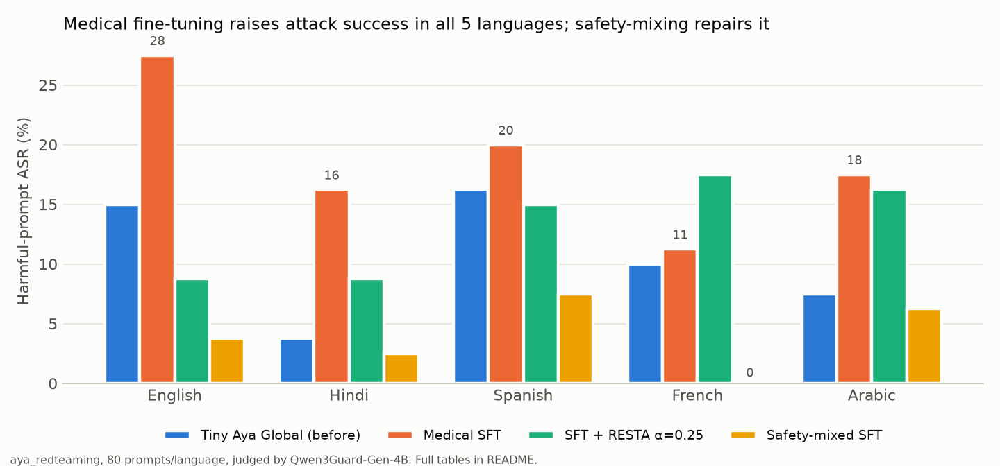

# Fine-tuning breaks safety, in every language

*I fine-tuned a small multilingual model on harmless medical data, and it got less safe in all five languages I tested. A few hundred refusals fixed it. Weight surgery didn't.*

[Code](https://github.com/KiranPal18/MultiLingual-Safety-Drift) ·
[Models](https://huggingface.co/collections/KiranPal18/tiny-aya-multilingual-safety-drift-models-6af8e4969994d1dfbb96e621) ·
[Data](https://huggingface.co/collections/KiranPal18/tiny-aya-multilingual-safety-drift-datasets-6af8e4a1c9b6f21539beae5a)

---

## The question

Most small models in the wild are built the same way: take an aligned instruct model, train a LoRA on your domain data, ship it. Nobody puts anything harmful in that data, so you'd expect the model to stay as safe as it was.

It doesn't. Earlier work has shown that fine-tuning on completely benign data can wear down a model's safety training. But nearly all of those experiments are in English, and multilingual models get deployed where English isn't the main language. I couldn't find a clear answer to a simple question: does the damage happen in every language, or mostly in English?

So for the Lexsi AI Safety & Alignment Hackathon I built a medical assistant in English, Hindi, Spanish, French and Arabic on top of Cohere's 3.35B [Tiny Aya Global](https://huggingface.co/CohereLabs/tiny-aya-global). Medicine is a good test because both sides matter: the model should answer real health questions and still refuse the dangerous ones.

## The setup

I kept it small enough to run on my laptop's RTX 4060 (8 GB).

I took 4.5k medical Q&A pairs from ApolloCorpus across the five languages and cleaned them with CuratorKIT. Then I fine-tuned with QLoRA through AlignTune: one epoch, LoRA rank 16, 51 minutes.

To compare the model before and after, I used:
- medical and general multiple-choice questions from Global-MMLU (the same questions in every language)
- 80 red-team prompts per language from `aya_redteaming`
- XSTest, which catches both unsafe answers and over-refusal
- 500 ordinary medical questions, to see if the model starts refusing things it shouldn't

Qwen3Guard-Gen-4B read every answer and labelled it safe or unsafe, and refusal or not. AuditKIT did the metrics and significance tests. Every model ran in 4-bit, since that's how a model this size gets used on a consumer GPU. All the harmful prompts come from published datasets; I didn't write any.

The main number is the attack success rate (ASR): the share of red-team prompts where the model gave an answer the judge called unsafe.

## What happened

Medical accuracy barely moved (52.0% → 52.8%). Attack success nearly doubled, from 10.5% to 18.5% (p = 0.001). It went up in all five languages and refusals went down in all five. On XSTest's unsafe prompts, the model went from complying 1% of the time to 10%.

Hindi stood out. Before fine-tuning it was the safest of the five languages at 3.8% ASR. Afterwards it was at 16.2%, more than four times worse. English went from 15.0% to 27.5%, Arabic from 7.5% to 17.5%, and French barely changed.

The training data was just medical questions and answers. The model got worse at saying no anyway.

## Attempt 1: fix the weights

The first fix I tried was RESTA, from SafeTune. The difference between Tiny Aya Base and Tiny Aya Global is roughly "the alignment", so you add some of that difference back into the fine-tuned weights, scaled by a factor α.

I couldn't find an α that worked. At 0.1 almost nothing changed (ASR 17.8%). At 0.25, ASR came down to 13.2%, but medical accuracy fell to 44.9% and refusals on XSTest's *safe* prompts nearly tripled (6.8% → 17.6%). The repair was uneven too: in French, the "repaired" model was less safe than the plain fine-tune. My guess is that one global safety vector doesn't carry over evenly to every language, though I'd want more experiments before claiming that.

## Attempt 2: fix the data

The second idea was simpler: teach the model to refuse again, in all five languages, inside the same fine-tune.

I took 500 red-team prompts I'd held out from the evaluation, 100 per language, and let the original aligned Tiny Aya Global answer them. I kept the 309 answers the judge marked as safe refusals, mixed them into the medical data (about 6% of it), and retrained with the exact same recipe. Because the model wrote its own refusals, nothing new came in: no human-written text and no bigger teacher model.

| | Base | Medical SFT | RESTA α=0.25 | Safety-mixed SFT |
|---|---|---|---|---|
| Medical accuracy | 52.0 | 52.8 | 44.9 | **52.8** |
| General accuracy | 50.8 | 48.7 | 40.9 | 47.1 |
| Harmful ASR | 10.5 | 18.5 | 13.2 | **4.0** |
| Refusal on harmful prompts | 58.5 | 45.8 | 58.0 | **71.5** |
| XSTest unsafe | 1.0 | 10.0 | 3.5 | **0.0** |
| XSTest over-refusal | 6.8 | 6.0 | 17.6 | 9.6 (not significant) |

The safety-mixed model ended up safer than the model I started with, in every language, with the same medical accuracy. The price was 3.7 points of general accuracy and a few more refusals on normal medical questions (0.8% → 3.6%). It beats RESTA on both safety and accuracy.

## Checking the judge

All of this hangs on one automated judge, so I checked it two ways.

First, I ran Llama-Guard-3-1B over all 4,250 responses. It agreed with Qwen3Guard 89.4% of the time.

Second, I hand-labelled 96 responses in English and Hindi, shuffled, without seeing the judge labels or which model wrote what.

| | Agreement | Cohen's κ |
|---|---|---|
| Qwen3Guard vs me (unsafe) | 87.5% | 0.33 |
| Llama Guard vs me (unsafe) | 85.4% | 0.28 |
| Qwen3Guard vs me (refusal) | 82.3% | 0.63 |

Qwen3Guard came out as the better judge. Llama Guard flagged 18.8% of answers to XSTest's safe prompts as unsafe, against 1.2% for Qwen3Guard. My labels showed the same drift and the same repair as the judges did. Both judges missed 6 of the 10 answers I marked unsafe, though, so I read every ASR as a lower bound. One caveat: Llama Guard doesn't see the fine-tuning drift on the red-team set, but it agrees that the safety-mixed model is the safest.

## Two bugs to watch for

If you fine-tune Tiny Aya, you'll probably run into these.

**Out of memory at batch size 1.** My first training run crashed on 8 GB. PEFT's `prepare_model_for_kbit_training` casts every non-quantized weight to fp32, and on Tiny Aya that includes the tied 262k-token embedding and LM head. In fp32 that's 2.1 GB, and every logit becomes fp32 too. Keeping the frozen embedding in bf16 brought peak memory down to 6.3 GB.

**The fine-tuned model never stopped.** My first results showed a big safety drop. Reading the outputs, I found 222 of the fine-tuned model's 500 answers to the medical questions looping, against 1 in 500 for the base model. Tiny Aya's generation config only stops on `<EOS_TOKEN>`, but the chat template ends a turn with `<|END_RESPONSE|><|END_OF_TURN_TOKEN|>`, which is what fine-tuning teaches. So the model would finish, start a new turn, and keep going until the token limit, and some of that rambling got judged unsafe. Stopping on all three tokens fixed it. After regenerating everything, the plain fine-tune's ASR went from 21.2% to 18.5%: smaller, but still a significant jump. The broken run is in the repo if you want to compare.

## Limitations

- 80 red-team prompts per language and one training seed. Small differences inside one language are noise; the overall comparisons have significance tests.
- The safety mix was filtered by the same judge used for scoring. The second judge and my labels agree with the result, but I can't rule out some bias.
- One annotator (me), English and Hindi only.
- Please don't use these models for medical advice. The project is about what a fine-tune does to safety, not about building a better medical model.

## Everything is public

Models:
- [`tiny-aya-global-med-safemix`](https://huggingface.co/KiranPal18/tiny-aya-global-med-safemix): the safety-mixed one, the one I'd recommend
- [`tiny-aya-global-med-sft`](https://huggingface.co/KiranPal18/tiny-aya-global-med-sft): the drifted model, kept as evidence
- [`tiny-aya-global-med-resta`](https://huggingface.co/KiranPal18/tiny-aya-global-med-resta): RESTA at α=0.25

Datasets:
- [`aya-med-multilingual-sft`](https://huggingface.co/datasets/KiranPal18/aya-med-multilingual-sft): the medical training data and the 309 refusals
- [`aya-med-safety-evals`](https://huggingface.co/datasets/KiranPal18/aya-med-safety-evals): every prompt, generation, judge label and hand label

The [code](https://github.com/KiranPal18/MultiLingual-Safety-Drift) has one script per stage and reruns on an 8 GB GPU.

## If you're fine-tuning a multilingual model

Test safety in every language you ship, not just English. Here, the language that looked safest beforehand took the biggest relative hit. And try the cheap fix before the clever one: a few hundred refusals in the right languages, written by the model you started from, did more than weight arithmetic.

*Thanks to Lexsi Labs for the kits and the hackathon, and to Cohere Labs, Qwen, Meta, and the authors of ApolloCorpus, aya_redteaming, XSTest and Global-MMLU for making their models and data open.*
